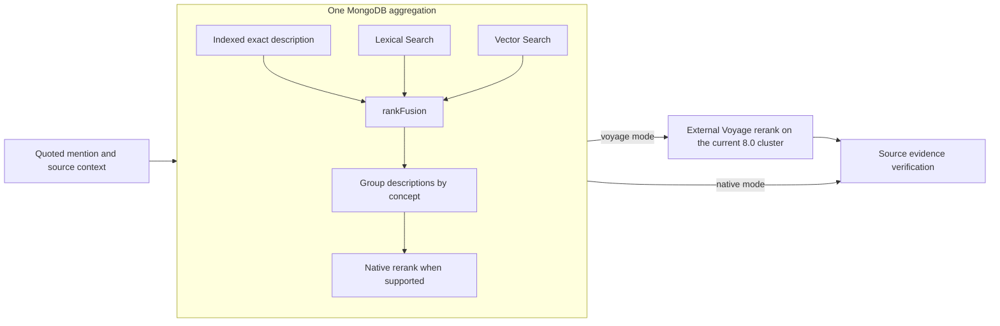

# Native grounding retrieval

Grounding uses one MongoDB aggregation per searched mention; native navigation
search uses the same retrieval design. The inputs are an
indexed exact-description lookup, MongoDB Search, and MongoDB Vector Search with
automatic query embedding. `$rankFusion` combines the inputs inside MongoDB;
the result is grouped to one candidate per concept. Negation, subject, time,
uncertainty and source-evidence verification remain separate clinical context.



The exact input has zero fusion weight so it can supply canonical descriptions
without changing the configured lexical/vector weights. Complete exact matches
receive explicit priority before the bounded rerank pool. This is a generic
description comparison, not a phrase-to-diagnosis rule. Reranking then orders
candidates; source verification can choose a supported alternative or leave the
mention for review.

Native fusion ranks description documents by `_id`, then the pipeline groups
them by `conceptId`. App-side RRF first groups each input by concept. These
approaches can produce different orders; changing to native fusion requires
candidate and source-evidence validation rather than assuming identical ranks.
Repeated mentions retain their own source context. A patient mention and a
family-history mention must not be collapsed simply because their text matches.

## Why the first `$match` contains identifiers

The exact input matches `normalizedTerm`, release, language, active description
and active concept. Its `typeId` values `900000000000003001` and
`900000000000013009` are standard RF2 identifiers for fully specified names and
synonyms. They select description types; they do not choose a clinical code.
An optional `conceptId` scope comes from the requested hierarchy/ECL expansion.
It is not an embedded list of diagnoses for this example.

`semanticTag` stores the source FSN's localized classification label. The
metadata exclusions therefore contain English and Spanish values even for
English searches. `languageCode` still filters the descriptions returned. The
source includes the Spanish extension and English descriptions; this filter is
not proof that the search uses Spanish-only terms.

Future projection work should derive a language-neutral classification from
the canonical SNOMED hierarchy and preserve the source label separately. The
current `semanticTagKey` only slugifies the localized label; it does not resolve
translations. Switching the filters to that field alone would not fix this.

## Latency and indexes

The November 13 read-only audit found both configured Search and Vector Search
indexes `READY` and queryable. No index rebuild was needed for this change.
The exact term lookup used the existing `term_release_language` B-tree index;
its database execution took 1 ms in the inspected no-hit plan.

The previous lexical pipeline projected scores/highlights and then sorted a
broad match set before applying its limit. The optimized pipeline sorts inside
`$search` and applies `$limit` before projecting highlights. Controlled checks
on three English/Spanish phrases preserved the returned concept sequence and
scores; their observed durations changed from 2364/347/3580 ms to 278/163/241 ms.
These are local observations, not a production latency guarantee.

The captured 27-mention oncology baseline took about 100 seconds and ran 101
MongoDB queries; the user's production screenshot showed 102. The first native
replay ran 27 aggregations, with candidate retrieval plus external Voyage
reranking taking 9.1 seconds and LLM source verification taking 18.8 seconds.
That first replay also exposed an LLM laterality error, so performance alone
does not establish a successful release. The final validation report records
the subsequent source checks.

The UI shows candidate-retrieval and source-verification times separately.
The progress label covers both phases rather than attributing all elapsed time
to MongoDB. Provider calls, candidate search, and evidence validation have
different latency budgets.

## Deployment settings

Current MongoDB 8.0.37 configuration:

```dotenv
HYBRID_FUSION_MODE=rankFusion
HYBRID_RERANK_MODE=voyage
HYBRID_RERANK_ENABLED=true
```

This runs one MongoDB aggregation and an external Voyage cross-encoder call
per searched mention. Keep the existing Voyage secret for this mode. App-side
RRF remains an explicit comparison mode; an unsupported native stage or timeout
returns a visible error instead of launching hidden fallback aggregations.

To put reranking inside that aggregation, operators must upgrade to MongoDB
9.0+ and enable **Native Reranking** in the Atlas project settings. Then test:

```dotenv
HYBRID_FUSION_MODE=rankFusion
HYBRID_RERANK_MODE=native
HYBRID_RERANK_ENABLED=true
VOYAGE_RERANK_MODEL=rerank-2.5
```

The prepared pipeline places `$rerank` after concept grouping, supplies a
non-null text field, bounds the rerank pool, and preserves fusion provenance
before capturing the reranker score. It does not make a separate application
Voyage call. No Search index rebuild is required solely to enable `$rerank`.
The current cluster rejects `$rerank` and `$scoreFusion`; do not enable either
there. The native rerank path has unit coverage, but requires live validation
on the upgraded cluster before production activation.

LLM verification remains a separate step in either mode. It checks candidate
equivalence against quoted source evidence, rather than merely query relevance.
A conservative English/Spanish evidence guard prevents an explicit source side
from disappearing from an automatically accepted mapping. It does not resolve
SNOMED identifiers or certify every anatomical qualifier. Unsupported or broader
mappings remain reviewable; projection gaps must not be filled with unrelated
codes.

The verifier receives copyable source spans and may make one bounded repair
call when its output fails identifier/citation validation. The repair is
validated again; the application never supplies a missing quote or invents a
code. Repair counts are returned in `semanticVerification`. An ungrounded
assessment also prevents a later numbered comorbidity from being promoted into
the principal diagnosis merely because its code is easier to retrieve.

## References

- [MongoDB full-text/vector hybrid search](https://www.mongodb.com/docs/vector-search/hybrid-search/vector-search-with-full-text-search/?embedding=auto&interface=driver&language=nodejs&pipeline-stage=rank-fusion)
- [Combining vector queries with rank fusion](https://www.mongodb.com/docs/vector-search/hybrid-search/vector-search-with-rankfusion/?embedding=auto&interface=driver&language=nodejs)
- [Native `$rerank` requirements and syntax](https://www.mongodb.com/docs/vector-search/query/aggregation-stages/rerank/)
